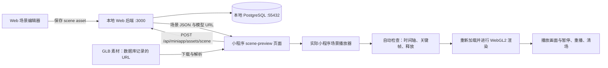

# Web → 小程序场景自动联调

本文记录已实现的本机联调流程：通过 Web 编辑器创建并保存 scene，在微信开发者工具中加载相同数据，使用小程序实际的 Three.js、GLB 加载器和场景播放器自动检查，再操作播放界面确认结果。适用于日常场景开发，也可作为 AI 自动调试的执行说明。

日常运行不需要手机或远程数据库。相机追踪、平面检测、GPS／识别触发和手机性能仍需单独做真机验收。

## 1. 数据和运行链路



- scene 是普通素材，编排 JSON 保存在 `asset.text_content`；模型作为独立 asset，被场景按 ID 引用。
- 场景接口按当前数据解析模型 URL；使用与场景同一工作空间的模型。协议与正式 AR 接入见 [Scene 素材播放](scene-asset.md)。
- 小程序通过 HTTP 接口访问后端，不直接连接数据库。素材可能仍从 OSS 下载；使用本地数据库不代表所有媒体都已离线。
- 联调页路径为 `labs/xr-three/scene-preview`。它使用模拟相机，跳过 VisionKit；复用正式代码中的 `backendRpc`、`ModelCache` 和 `createCompositionPlayer`。

## 2. 首次准备环境

两个仓库通常相邻放置：

```text
spatial-memory/
  sanlinlaojie/          # Web、后端、数据库配置
  xr-frame-plant-trees/  # 小程序、场景播放器、联调脚本
```

1. 在 Web 仓库确认 `.env.local` 的 `DATABASE_URL` 指向本地开发库。当前开发环境使用 `localhost:55432/sanlin`。启动已有数据库；若已有 `sanlin-dev-db` 容器，可运行 `docker start sanlin-dev-db`。不要为了联调覆盖现有数据。
2. 在 Web 仓库启动服务：

   ```sh
   npm run dev -- --hostname 0.0.0.0 --port 3000
   ```

   若 3000 已有本项目的服务，直接复用。小程序与准备脚本均使用 3000，不要另起自动换端口的实例。
3. 首次在小程序仓库运行 `npm install`。安装后的脚本会生成本机开发地址文件。
4. 在微信开发者工具打开 `xr-frame-plant-trees` 项目根目录。在“设置 → 项目设置 → 本地设置”启用“自定义处理命令”，三个预处理命令均为：

   ```sh
   sh scripts/sync-dev-backend.sh
   ```

   本机已启用。工具自身保存此开关，新电脑不能仅依赖 `project.config.json` 中的 `scriptsEnable`。
5. 确认本地设置保留“不校验合法域名”，在模拟器运行开发版。联调页仅允许 `develop`；体验版和正式版不会初始化该页 GPU 或请求场景。

地址切换、Node.js 查找与多网卡配置详见 [本地开发环境](local-development.md)。当前 shell 启动脚本适用于 macOS/Linux；Windows 的命令配置也见该文档。

### 2.1 微信开发者工具内置 Skill 与 CLI

小程序侧优先使用官方 `wechatide-skill` 和 `wechatide` 执行项目查询、编译、运行时读取、页面交互与截图；Web 编辑器仍使用浏览器。2026-10-14 本机已通过这条调用链完成授权和只读取证，未另行配置独立 MCP server。

先检查实际安装内容，不要仅凭“稳定版／Nightly”判断是否支持。此次本机稳定版 `2.02.2608060` 已带有 `wechatide-skill 0.3.9`。macOS 本机路径为：

| 内容 | 路径 |
|---|---|
| CLI 原始入口 | `/Applications/wechatwebdevtools.app/Contents/MacOS/wechatide` |
| 官方只读 skill 包 | `/Applications/wechatwebdevtools.app/Contents/Resources/app.asar.unpacked/wechatide-skill` |
| 已导入的 agent skill | `~/.agents/skills/wechatide-skill` |
| 本次补齐的 CLI 软链 | `~/.local/bin/wechatide`，指向上述原始入口 |

首次导入 skill 或 CLI 不可用时，在官方 skill 包根目录执行：

```sh
node skills/installer/scripts/check-installation.mjs
# 仅在 compatible: true、App 内 CLI 存在但 PATH 找不到命令时执行：
node skills/installer/scripts/ensure-cli-path.mjs
```

本次诊断返回 `compatible: true`；补软链后即可调用，无需重新下载开发者工具。若返回 `mustEnterInstaller: true`，再按内置 `skills/installer/SKILL.md` 处理安装或更新。首次导入／版本落后时，将官方 skill 包整目录单向复制到 agent 的 skills 目录，重新加载后核对版本；不得把 agent 侧文件写回 `.app` 安装目录。

每个会话首次使用前，读取当前 agent 已加载的 `SKILL.md` frontmatter 版本再检查状态。以下 `0.3.9` 是本次版本，升级后应替换：

```sh
wechatide -c Codex check_wechatide_status --skill-version 0.3.9
```

- `versionRelation: equal` 且 `loginExpired: false` 表示版本一致、微信登录有效；还需处理 `tokenRequired`。`agent_behind` 时先同步 skill；`agent_ahead` 按内置 skill 处理兼容性，不回写安装目录。
- 首次连接可能先提示 `Failed to connect to WechatIDE`，随后自动发起 `auth` 并返回 `pending + taskId`。这时应提醒用户在开发者工具内确认 Codex 授权，不能直接判定安装失败或重复发起授权。
- 对 `auth`／`login`，按内置规则每 10 秒查询 `wechatide -c Codex polling_task_result --task-id <返回的任务ID>`，最多 10 次；只有最终 `success` 才继续。授权／登录完成后重新检查状态。其他待确认写操作保留 taskId，按对应 skill 恢复，不套用此轮询循环。
- 本次授权后 `tokenRequired: false`。若以后为 `true`，按 skill 复用已保存的令牌或请用户提供“设置 → 安全”中的 CLI 访问令牌，不从开发者工具本地文件翻找，不写入仓库或日志。
- CLI 需要能够访问本机桌面的执行环境。会话就绪后复用检查结果，不必每条命令都重新授权。

以已安装版本的 `SKILL.md`、工具索引和 `wechatide <toolName> --help` 为准。本次版本使用 `wechatide -c Codex <toolName>`，例如 `check_wechatide_status`、`open_project_window`、`get_simulator_console`；旧资料里的 `-t` 调用方式和其他版本工具名不可直接照搬。

## 3. 一次完整联调

### 第一步：在 Web 创建、编排并保存

打开本地 `/manage`，选择本地库中的工作空间，创建 scene 素材并进入 `/manage/scenes/<sceneAssetId>`。

建议首个验收场景包含同一 GLB 的两个实例，一段位移动画和一段旋转动画，总时长 6 秒。这样能同时验证资源复用、实例独立性和关键帧传递。若需要验证 GLB 内置动画，应另选确实包含动画片段的模型，并配置 clip 和开始时间。

添加模型、设置位置和关键帧后点击保存，确认“已保存”，重新打开编辑器核对实例、时长和关键帧仍然存在。空白场景可以作为草稿保存，但联调脚本要求至少一个实例。

记录两个 UUID：

| 参数 | 含义与获取方式 |
|---|---|
| `sceneAssetId` | 场景素材 ID，取自编辑器 URL 的最后一段 |
| `workspaceId` | 创建场景时所选工作空间 ID，可从创建素材的请求地址 `/api/workspaces/<workspaceId>/assets` 中读取 |

两个 ID 必须来自当前本地库，且场景属于该工作空间。不要沿用线上扫码历史里的 ID 来猜测本地记录。

### 第二步：准备小程序入口

在小程序仓库执行，替换尖括号内的参数：

```sh
npm run scene:preview -- <sceneAssetId> <workspaceId>
```

命令会依次：

1. 通过 npm 的 `prescene:preview` 同步本机开发 IP。
2. 请求 `http://127.0.0.1:3000/api/miniapp/assets/scene`，检查 HTTP 返回、场景 ID 和非空实例，接口超时为 15 秒。
3. 在 `project.private.config.json` 新增或更新「Scene 本地全流程验证」编译条件，保留其他条件。

生成的启动参数为：

```text
路径：labs/xr-three/scene-preview
query：assetId=<sceneAssetId>&workspaceId=<workspaceId>
```

命令成功说明本地接口和入口已就绪。它不会启动开发者工具、操控 Web 编辑器，也不会独立完成 GPU 或画面验收。

### 第三步：在开发者工具运行自动检查

选择「Scene 本地全流程验证」并完整编译；AI 执行时可使用第 5.1 节的 `simulator_open_page` 传入相同页面和参数。页面会自动读取场景、下载 GLB、运行检查，释放本轮实例，再重新加载供查看和操作。

成功时可看到：

- `PASS · N 项检查通过` 和逐项报告。
- 模型实际画面，以及 `playing / paused / ended`、播放时间、实例数量。
- 控制台中的 `[ScenePreview] PASS`，包含场景 ID、工作空间 ID、检查清单及协议版本。

检查项数量由当前场景决定，不要求所有场景都显示 21 项。失败时页面显示 `FAIL · 原因`，控制台输出 `[ScenePreview] FAIL`；修复对应问题后重跑。

### 第四步：操作界面并确认画面

1. 点击“重播”，确认回到起点，模型按预期运动。
2. 点击“暂停 / 继续”，确认暂停时画面和时间保持，再继续时从暂停位置推进。轻触画布也会切换播放。
3. 点击“清场”，确认模型移除、播放按钮禁用。
4. 点击“加载并自动验证”，确认再次通过检查、模型恢复。
5. 保存 Web 编辑器和小程序结果截图，记录本轮场景 ID、检查结果和实际操作结果。

GPU 检查确认有模型三角形提交且没有捕获到着色器编译错误，并不判断画面是否符合创作意图。摆放、缩放、纹理和运动仍需结合画面检查。

### 第五步：修改后重复验证

| 本轮修改 | 后续操作 |
|---|---|
| 同一 scene 的模型编排或关键帧 | Web 保存后，在小程序点击“加载并自动验证” |
| 切换 scene 或 workspace | 重新运行 `scene:preview` 并选择该编译条件；也可在页内填写两个 ID 后加载 |
| 修改小程序 JS、运行时或环境配置 | 完整编译，再运行检查；不要只依赖热重载 |
| 页面隐藏后返回 | 隐藏时已停止动画并清场，返回后点击加载 |
| 电脑切换 Wi-Fi，继续模拟器联调 | 保持本地后端运行；模拟器使用 `127.0.0.1` |
| 电脑切换 Wi-Fi，继续真机开发 | 重新编译／预览，让手机扫码新包；IP 在电脑端自动更新 |

## 4. 自动检查覆盖范围

| 检查 | 验证内容 | 适用条件 |
|---|---|---|
| 加载与实例 | 播放器就绪、实例非空且数量匹配、各实例模型对象独立、实例位置为有限数值 | 所有场景 |
| 时间控制 | 播放推进、暂停保持、继续播放、重播回到零点 | 所有场景 |
| 保存关键帧 | 运行到保存时间，比较实际变换与保存值，容差 `0.0001` | 存在变换轨道；循环场景跳过恰好等于总时长的帧 |
| GLB 动画 | 配置的片段已形成播放 action；延迟开始前保持首帧 | 实例配置了内置动画；延迟检查要求开始时间大于零 |
| 整场时间边界 | 非循环场景结束冻结；循环场景正确保留越界余量 | 设置了总时长 |
| 清理 | dispose 后节点清空、模型缓存引用数全部归零 | 所有场景 |
| 实际渲染 | 检查后重载成功、WebGL2 提交三角形、没有捕获到 shader 错误 | 开发者工具中的联调页 |

Node 回归另覆盖循环、延迟片段、故意破坏时间推进时能否检出，以及页面隐藏和环境隔离。没有内置动画的实际模型不能据此宣称该模型的骨骼动画已验收。

联调页不覆盖正式 AR 入口的触发与空间追踪：GPS 距离判定、匹配点识别、相机画面、平面检测、锚定稳定性、手机权限及真机内存／帧率都需要对应环境验证。

## 5. AI 全流程执行约定

用户要求“全流程自动调试”时，AI 使用浏览器操作 Web 编辑器，小程序侧优先使用官方 Skill + `wechatide`；需要 CLI 未覆盖的工具设置时再使用开发者工具界面。当前仓库提供准备脚本、可自动检查的小程序页面和回归脚本，官方 CLI 提供操作与取证能力；这些步骤仍需按结果依次执行，没有一条仓库命令能完成全部流程，也没有常驻后台任务。

执行顺序：确认本地服务 → 在 Web 创建或按任务指定复用场景 → 保存并重新打开核对 → 准备编译入口 → 实际编译运行 → 读取 `PASS/FAIL` → 检查画面并操作控制按钮 → 修复并重跑受影响环节 → 保存证据、报告结果。

验收报告须分别说明：

- Web 是否实际保存、重新打开是否保持内容。
- 命令检查、Node 回归、小程序 GPU 运行分别是否通过。
- 实际操作过哪些按钮，观察到什么结果。
- 使用的是模拟器还是真机，以及未覆盖的环节。

本地接口成功、Node 测试通过、编译成功，均不能单独替代小程序实际运行结果。修改已有场景需符合当前任务范围；测试场景应命名清楚，避免混入正式内容。

### 5.1 用官方 CLI 执行与取证

完成第 2.1 节门禁后，先 `project_list` 确认绝对路径。同名项目可能同时存在于 `WeChatProjects` 和当前工作区，不能只按显示名称选项目。本次使用的是 `/Users/wangzhewei/Working/spatial-memory/xr-frame-plant-trees`。

以下在小程序仓库根目录执行。项目列表、当前页、截图和错误日志查询已在本次接入中实测；打开联调页及读取联调状态的参数已核对本机 `--help`，仍需在每轮联调中实际运行验收。

```sh
MINIAPP_PROJECT="$(pwd)"
wechatide -c Codex project_list
wechatide -c Codex automation_runtime_info --project "$MINIAPP_PROJECT" --action currentPage
```

窗口尚未打开时，使用 `open_project_window --project "$MINIAPP_PROJECT"`；已打开则复用。按第 3 节确认本地场景已保存，并运行 `scene:preview` 后，替换下面两个 UUID，编译并进入联调页：

```sh
wechatide -c Codex simulator_open_page --project "$MINIAPP_PROJECT" \
  --page labs/xr-three/scene-preview \
  --query 'assetId=<sceneAssetId>&workspaceId=<workspaceId>'
```

`simulator_open_page`／`simulator_refresh` 成功只表示触发动作。随后核对当前页和 query，读取最新页面状态、逐项报告与日志，确认本轮场景真实运行：

```sh
wechatide -c Codex automation_runtime_info --project "$MINIAPP_PROJECT" --action currentPage
wechatide -c Codex automation_page_action --project "$MINIAPP_PROJECT" --action getData --data-path status
wechatide -c Codex automation_page_action --project "$MINIAPP_PROJECT" --action getData --data-path report
wechatide -c Codex get_simulator_console --project "$MINIAPP_PROJECT" --command 'grep -F "[ScenePreview]"'
wechatide -c Codex get_simulator_console --project "$MINIAPP_PROJECT" --command 'grep -i error'
wechatide -c Codex simulator_screenshot --project "$MINIAPP_PROJECT"
```

等待页面从加载态进入本轮 `PASS/FAIL`，不要用日志缓冲中的旧 `PASS` 代替本轮状态。`get_simulator_console` 的 `--command` 接受 grep 命令；空结果只表示没有匹配行，需要完整日志时用 `grep -n .`。`grep -i error` 也可能匹配包含 `TypeError` 的 warning，不能仅凭匹配结果给日志定级。

按第 3 节操作暂停、继续、重播、清场和重新加载。使用 `automation_page_action --action querySelectorAll --selector button` 核对元素，再用 `automation_element_action --action tap --selector <已核实的选择器>` 真实点击，并比较操作前后的页面数据与画面。不要用 `setData` 或直接调用页面方法代替按钮交互验收。具体参数按本机 help，场景规则见内置 `automator`／`debugger` skill。

截图应使用 `simulator_screenshot`，读取返回的 `path` 并实际检查图片。默认截图写到系统临时目录；交付前复制到本轮证据目录，或通过 `--path` 指定绝对输出路径。网络失败时按本机 `get_simulator_network --help` 补取请求证据，再判断是哪一个资源或接口失败。

## 6. 回归命令与故障定位

以下命令均在小程序仓库执行：

| 命令 | 用途 |
|---|---|
| `npm run dev:sync` | 查看并生成当前电脑的真机开发地址 |
| `npm run test:backend` | 地址检测、换网、多网卡、离线清理及各环境接口选择 |
| `npm run test:scene-preview` | 用真实 GLB 二进制 fixture 检查播放器断言及联调页生命周期；微信边界使用替身 |
| `npm run test:scene-asset` | 场景播放、时间轴、轨道、加载失败、取消与正式素材队列接入 |
| `npm test` | 小程序完整本地回归，包含上述相关检查 |

这些测试不要求远程数据库，也不会完成真实 GPU 画面验收。修改逻辑后运行对应回归；完成一轮实现后按影响范围运行完整回归。

| 现象 | 排查与处理 |
|---|---|
| `wechatide: command not found`，但 App 内有 CLI | 在内置 skill 包中跑安装诊断；兼容时用 `ensure-cli-path.mjs` 补软链，当前 shell 也可使用诊断返回的绝对入口。不要仅因 PATH 缺失重装 |
| 首次连接报错后返回 `auth` 的 `pending + taskId` | 等待开发者工具内的用户授权，查询该任务终态，再检查登录和版本；不要重复发起授权 |
| CLI 查询到其他同名项目或页面不符 | 用 `project_list` 核对项目绝对路径，再用 `automation_runtime_info` 检查当前页和 query |
| CLI 返回成功，但未见本轮 `PASS` | 动作被接受不代表运行验收通过；读取当前页面 status/report、当前场景参数和最新日志，并检查实际画面 |
| WASM streaming compile／async fetch 失败 | 保留具体错误、当前页面与请求证据，定位 WASM URL、HTTP 状态及调用方后判断影响。首页可见不能证明 AR／WASM 链路正常，也不能据此断言 scene-preview 已失败 |
| `scene:preview` 请求失败／超时 | 检查本地数据库、Web 3000 服务及其日志，确认没有自动换到 3001；不要切线上来绕过问题 |
| 场景不存在、工作空间不匹配 | 核对本地库中的两个 UUID，以及当前 Web 所选工作空间 |
| “请先在 Web 编辑器添加模型并保存场景” | 场景仍为空草稿或编辑器尚未保存；至少添加一个模型并保存 |
| GLB 加载失败或依赖错误 | 检查模型是否仍在同一工作空间、URL 是否可下载、GLB 是否能解析，以及所选 clip 是否存在 |
| 停在“等待 WebGL2”／热重载后无反应 | 完整编译该模式；旧页面可能保留已销毁状态。上下文丢失也需重新编译 |
| IP 没有自动更新 | 检查界面的“启用自定义处理命令”，确认三个钩子为 `sh scripts/sync-dev-backend.sh`；文件配置本身不等于工具已启用 |
| 预处理报 `node: command not found` | 确认使用 shell 启动脚本；它会查找 PATH、Homebrew、nvm。再检查电脑的 Node.js 安装 |
| 多网卡无法自动选择 | 在仓库根目录 `.miniapp-dev.local.json` 指定 `{"interface":"en0"}` 等实际网卡名，之后 IP 仍自动获取；配置方法见本地开发文档 |
| 真机仍请求旧 IP | 重新预览并扫码新包。地址是在编译时注入代码包的，手机不会运行电脑上的检测脚本 |
| `PASS` 但画面不符合预期 | 检查模型尺寸、变换、材质和动画；自动断言不提供像素级画面对比 |

## 7. 已完成的联调记录

### 7.1 场景完整联调（2026-10-14）

2026-10-14 已通过 Web 界面创建并保存「本地联调 · 双模型动画 1014」，重新打开确认后，在微信开发者工具中运行成功。

| 项目 | 记录 |
|---|---|
| 场景 ID | `d6fe703f-5b43-41a7-b25e-53ea690b2d8d` |
| 工作空间 ID | `02212116-256b-4b60-9e0c-a5e089862232` |
| 编辑入口 | [本地测试场景](http://localhost:3000/manage/scenes/d6fe703f-5b43-41a7-b25e-53ea690b2d8d) |
| 内容 | 协议 2，同一 GLB 的两个独立实例，位移与旋转关键帧，6 秒，整场不循环 |
| 小程序结果 | 21 项检查通过，WebGL2 提交 248 个三角形 |
| 界面操作 | 暂停、重播、清场、重新加载通过 |
| 回归 | `npm test` 通过 |
| 边界 | 实际模型不含 GLB 内置动画；本次验证其变换关键帧。没有进行真机 AR 验收 |

本机证据保存在工作区根目录 `scene-validation-20261014/web.jpg` 和 `scene-validation-20261014/miniapp.jpg`，未纳入本仓库。此记录是历史结果；再次运行仍需读取最新结果。本地库若没有这些测试记录，应重新创建场景。

复用该场景：

```sh
npm run scene:preview -- d6fe703f-5b43-41a7-b25e-53ea690b2d8d 02212116-256b-4b60-9e0c-a5e089862232
```

后续每轮记录日期、环境、两个 UUID、场景内容、`PASS/FAIL` 清单、实际界面操作、回归命令结果、截图位置及待真机验证事项。

### 7.2 官方 Skill + CLI 接入验证（2026-10-14）

此记录验证工具连接与只读取证，不作为第 7.1 节场景验收的重跑结果。

| 项目 | 记录 |
|---|---|
| 环境 | macOS arm64；微信开发者工具 `2.02.2608060`（稳定版），内置 skill `0.3.9` |
| 接入 | 安装诊断兼容；补齐 `~/.local/bin/wechatide` 与 `wechatidecli` 软链；完整复制 24 个 skill 文件到 `~/.agents/skills/wechatide-skill`，文件哈希一致 |
| 授权与状态 | 用户在开发者工具中批准 Codex；auth 任务最终 `success`；状态为 `versionRelation: equal`、`loginExpired: false`、`tokenRequired: false` |
| 项目列表 | 成功读取 7 个项目；按绝对路径选定当前工作区项目 |
| 当前页面 | `pages/index/index`，query 为空，标题 `Spatial Memories` |
| 画面 | `simulator_screenshot` 成功返回 591 × 1280 图片；实际看到“东明／街道空间”和“开启旅程”入口 |
| 控制台 | 成功读到 WASM streaming compile 的 HTTP 状态错误，以及 async/sync fetching 均失败的 warning；根因和实际影响尚未排查 |
| 验证边界 | 本次未运行 scene-preview 场景检查、播放按钮验收或真机 AR；未执行上传、发布或云资源写操作 |

本次首页截图已从系统临时目录复制到工作区 `scene-validation-20261014/wechatide-homepage.jpg`，未纳入本仓库。后续排查 WASM 时，应记录触发页面和失败请求；不要把本次连接成功等同于业务链路全部通过。

## 8. 实现入口

| 文件 | 职责 |
|---|---|
| [prepare-scene-preview.cjs](../scripts/prepare-scene-preview.cjs) | 检查场景接口，生成编译条件 |
| [scene-preview.js](../miniprogram/labs/xr-three/scene-preview.js) | 小程序联调页、实际渲染、播放控制和生命周期 |
| [scene-checks.js](../miniprogram/labs/xr-three/scene-checks.js) | 针对已加载场景的确定性检查 |
| [composition.js](../miniprogram/lib/scene-runtime/composition.js) | 联调页与正式 AR 共用的场景播放器 |
| [backend-environment.ts](../miniprogram/utils/backend-environment.ts) | 模拟器、真机开发、体验版和正式版地址选择 |
| [sync-dev-backend.cjs](../scripts/sync-dev-backend.cjs) | 电脑网卡检测与本机地址文件生成 |
| [sync-dev-backend.sh](../scripts/sync-dev-backend.sh) | 开发者工具执行脚本时定位 Node.js |
